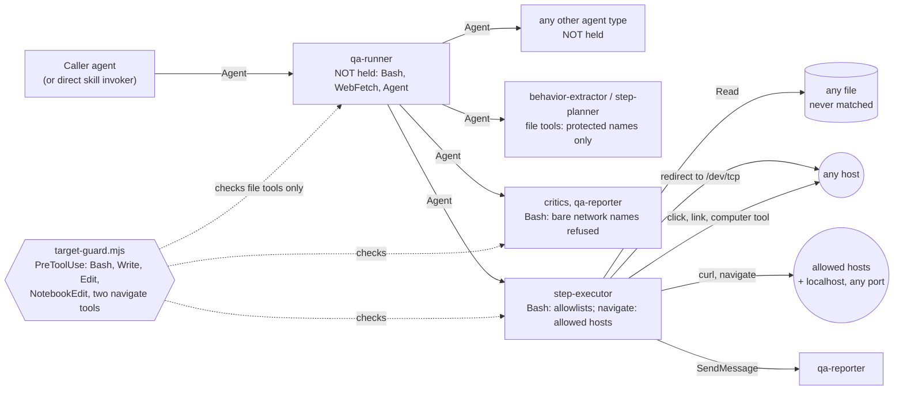

# agentic-qa review — November 2026, second pass

A review of the `agentic-qa` plugin at 0.4.0, read at `6929ce5`, the guard
allowlist commit that lands alongside this review. All line citations refer to that commit. It is
judged against one use: an unattended run against a staging web app, where nobody
watches the run or approves steps. A safeguard that exists only as an instruction to
an agent is treated as absent unless something enforces it.

Finding numbers continue from the [November review](agentic-qa-review-2026-11.md),
which ended at F41. The review was done in three passes: the run from start to finish,
untrusted input (the guard above all), and authorisation and cost. It then compares
its results with the [September](agentic-qa-review-2026-09.md) and November reviews.

## Conclusion

0.4.0 should not run unattended yet, even with the README's network boundary in
place. The enforced boundary has three gaps that each undo it completely:

- The executor can open a raw network connection to any host through a shell
  redirect (F42).
- It can delete or move the hook, after which every call in the session is allowed
  (F43).
- Several shell constructs make bash run commands the guard's parser never saw
  (F44, F45).

Separately, `qa-runner` can edit the allowlist through Bash (F46). It is the agent
that reads the ticket first, and it is not held at all.

A network boundary that limits egress to staging contains F42 and F44's network
effects. It does not contain F43, F46, F48 or F57: those act on the machine's files
and the `gh` credential, so they need an OS-level boundary as well. That means a
disposable container or user account, with the plugin directory and the allowlist
read-only and a read-only `gh` token.

On the run itself, the rerun protection added for F28 is not wired into the
unattended path (F53). Several ordinary operations are refused by the guard, and each
refusal stalls the run in an escalation (F54, F55).

## Evidence

Each finding states its basis:

- **Probed:** confirmed by running the guard's own exported functions
  (`checkExecutorBash`, `checkRestrictedBash`, `decide`, `parseSettings`,
  `loadSettings`) on the input in question, or by running `node` or `git` directly.
  `node --test hooks/target-guard.test.mjs` passes 29 of 29 at `6929ce5`.
- **Probed + reasoned:** the guard's decision was probed, and what the shell or OS
  then does was reasoned from documented behaviour. At the owner's request, no string
  meant to get past the guard was run in a real shell. Running them in a sandbox is in
  the last section.
- **Reasoned:** read from the instructions, which are the implementation for
  everything but the hook. This covers what an agent following them would plausibly
  do, including where a step can be read two ways.

Probes ran on native Windows: Node 22.17.1, Git Bash 5.3, and the git on this machine.

## Where enforcement applies

---

## Pass 2 — untrusted input and the guard

### F42 — High — a shell redirect reaches any host, bypassing the curl checks

`hooks/target-guard.mjs:507-511` checks a redirect target only for a variable or glob
and against the protected-file names. Bash treats a redirect to `/dev/tcp/<host>/<port>`
or `/dev/udp/…` as a network connection. **Probed:** writing to, reading from, or
opening such a path is allowed for the executor with any host, including
`169.254.169.254` and an unlisted domain.

Scenario: a page or response tells the executor to "post diagnostics". The executor
redirects `runtime-secrets/s1-auth_token`, or anything else it can read, to an
arbitrary host. Every `curl` check, the `-q` rule and the host allowlist are bypassed.
This undoes the Bash half of F24's enforcement.

Basis: **Probed + reasoned.** `/dev/tcp` is a documented bash redirection feature.

Fix direction: allow redirects only to `/dev/null`, `/dev/stdout` and `/dev/stderr`
among `/dev/*`. Better, allow them only to paths inside the run's working directory.

### F43 — High — the agent it guards can remove the guard

`PROTECTED_FILE` (`:56`) protects the names `target-guard.mjs` and `hooks.json`, not
the directory holding them. `rm`'s arguments are never checked for globs, because
`unsafeDestination` is applied only to write targets (`:52`, `:539-542`). `mv` on a
directory named `hooks` is not protected at all. **Probed:** each of these is allowed:

- `rm -rf <plugin>/hooks`
- `rm` of the script through a glob
- a globbed path into the installed plugin cache
- `cd` into it with a glob, then `mv hooks …`

**Probed:** `node` on a missing script exits 1. The README (`:72`) and Claude Code
both treat a hook that fails that way as non-blocking. The hook command re-reads the
script on every call (`hooks/hooks.json:10`). So once the script is gone, every later
Bash, Write and navigate call from every plugin agent is allowed for the rest of the
session. README `:70` says agents are stopped from writing "the hook"; that leaves
deleting and moving it open.

Basis: **Probed** for the guard's decisions and node's exit code. **Reasoned** for
Claude Code's non-blocking treatment, which the README itself states.

Fix direction: install the plugin where the agents' OS user cannot write. A hook
wrapper that exits 2 when node fails would close this, but it would also block every
other session's Bash calls whenever node is missing.

### F44 — High — bash runs commands the guard's parser never saw

The guard decides on its own parse of the command. Where that parse and bash disagree,
bash can run a command the guard never checked. **Probed:** the guard allows each of
the following, and in each one bash would run a command hidden from it:

- **Heredoc delimiters.** The delimiter regex (`:225`) takes only the leading run of
  word characters, so a partly quoted delimiter ends the heredoc on a different line
  from bash's.
- **Heredoc terminators.** `skipHeredocs` strips leading tabs whether or not the
  heredoc used `<<-`, and strips a trailing CR (`:274-276`). Bash does neither for a
  plain `<<`, so the two disagree on where the body ends.
- **Parentheses in quotes.** `matchParen` (`:257-264`) counts parentheses inside
  `"$(…)"` without regard to quotes.
- **Expansions that evaluate a value.** The guard treats a single-quoted assignment as
  inert data. Bash's `${var@P}` transformation evaluates its value, and so does
  arithmetic evaluation. Arithmetic covers `$(( ))`, substring offsets and array
  subscripts, and it evaluates a variable's text recursively, including any `$(…)`
  in a subscript.

Any one of these gives the executor unrestricted commands. That includes everything
F42 to F48 describe, without needing their specific gaps. The November review
predicted this class ("a guard that parses shell text is incomplete by nature"). These
are new instances, not regressions of fixed ones.

Basis: **Probed + reasoned.** The bash-side behaviour is documented. The probe strings
were not run in a shell.

Fix direction: shrink the accepted grammar rather than adding cases. Accept only
`<<'TAG'` heredocs, matched exactly; reject `${` with any operator, `$((`, and
array subscripts; reject `$(` inside double quotes.

### F45 — High on Windows — a backslash inside double quotes hides a protected path

Inside double quotes the parser drops every backslash and keeps the next character
(`:194`). Bash keeps the backslash unless it comes before `$`, `` ` ``, `"`, `\` or a
newline. A Windows path with a backslash inside quotes is therefore checked as a
different string. For example, `".claude\agentic-qa.local.md"` is checked as
`.claudeagentic-qa.local.md`, which matches no protected pattern. **Probed:** redirects
to the home allowlist and to `.bashrc`, written this way, are allowed.

Scenario: the executor adds a production host to `~/.claude/agentic-qa.local.md`.
`loadSettings` reads the file on every hook call, so the next `curl` to that host
passes.

Basis: **Probed + reasoned.** That Git Bash passes the backslash through and Windows
treats it as a separator is about 75% certain. A sandboxed write would settle it.

Fix direction: inside double quotes, drop a backslash only before those five
characters, as bash does.

### F46 — High — `qa-runner` and a direct invoker are not held, and can edit the allowlist

`decide` returns `null` for any plugin agent other than the executor and the three
network-restricted ones (`:600-603`). It returns `null` for every non-plugin agent at
`:596`. **Probed:**

- A `qa-runner` Bash command appending a host to `~/.claude/agentic-qa.local.md` is
  allowed; only its Write tool is refused.
- The same command from a `general-purpose` agent, or from a caller running the skill
  directly, is allowed.

`qa-runner` holds `Agent` (`agents/qa-runner.md:4`), so it can spawn an unguarded
agent type. It is the first agent to read the ticket and docs (`:22`), the most
attacker-reachable input in the run. It runs unrestricted `Bash`, `WebFetch` and
`gh`. "You never add to either list" (`:22`) is an instruction.

README `:70` says the hook "stops this plugin's agents writing to the allowlist
files". That is true of file tools and false of `qa-runner`'s Bash. README `:71`
discloses that `qa-runner` isn't restricted, but not this consequence.

Basis: **Probed.**

Fix direction: give `qa-runner` its own command list. It needs `gh` read subcommands,
`curl` for reachability, `git ls-files` and `git merge-base`, its wait loop, and
removing `runtime-secrets/`. Add `Agent` to the matcher and refuse any `subagent_type`
outside `agentic-qa:`.

### F47 — Medium — protected files can be read and sent to an allowed host

- `Read` is outside the hook's matcher (`hooks/hooks.json:6`). The executor holds it
  (`agents/step-executor.md:4`), so it can read `~/.ssh` and `~/.aws` directly.
- Through Bash, a glob avoids the name check (`cat ~/.ss?/…`). **Probed.**
- `checkCurlValue` (`:309-311`) looks for `@file` only in data options, with a regex
  that misses several forms. **Probed:** these all pass:
  - `-H @file`
  - `-b file`
  - `--data-urlencode name@file`
  - `-F 'a=@file;type=…'`
  - a brace-expanded attached value such as `-d{@file,x}`
- Environment variables reach the target too: `"$GH_TOKEN"` in a body, and
  `jq -n env`.

The destination is an allowed host, which is the staging app and its logs, or any
host with F42.

Basis: **Probed** for the guard. **Reasoned** for curl's and bash's option and brace
handling.

### F48 — Medium — files that change later sessions are still writable

The `.claude` check is applied to the literal text. **Probed:** each of these is
allowed:

- `cd` with a glob (`:538` refuses only a variable), followed by a relative write
  such as `agents/evil.md`.
- A relative `..` path out of the exempt scratchpad (`:64`, `:69`).
- `~/.claude.json`, `.bash_aliases`, `.zlogin` and the PowerShell profile.
- `.npmrc`, `.github/workflows/*`, and this plugin's own `agents/` and `plugin.json`.
- `sed -in p X`. `checkSed` reads `-in` as `-i -n` (`:432`), but GNU sed reads it as
  in-place editing with backup suffix `n`. It therefore writes the original of `X` to
  `Xn`, a name the guard never checked. A `.mcp.jso` the executor wrote becomes
  `.mcp.json`, and `hooks.jso` becomes `hooks.json`.

Scenario: a hostile instruction is followed once, and what it writes loads into later
sessions as an agent, a skill, an MCP server or a shell startup line. A run container
doesn't help if the home directory persists.

Basis: **Probed** for the guard. **Reasoned** for GNU sed's `-i[SUFFIX]` parsing,
which is documented.

### F49 — Medium — any git error makes the guard honour a committed allowlist

`isTracked` (`:104-111`) treats every failure of `git ls-files --error-unmatch` as
"not tracked". **Probed:** in a repository whose `.claude/agentic-qa.local.md` is
committed, both of these load its hosts:

- a corrupt `HEAD`, where git exits 128
- git missing from the hook's `PATH`

`git ls-files` fails the same way on a checkout owned by another user ("detected
dubious ownership"). That is common in CI containers, the environment README `:74`
recommends. Intake's own instruction has the same rule: "tracked … (`git ls-files
--error-unmatch` succeeds)" (`skills/agentic-qa/SKILL.md:39`). So the model's check
fails open too.

Basis: **Probed.**

Fix direction: an untracked file exits 1 (**probed**). Treat only exit 1 as untracked,
and anything else as tracked, so the file is ignored.

### F50 — Medium — valid YAML yields an empty list, and the run fails step by step

**Probed:** `parseSettings` (`:88-102`) returns no hosts for:

- `- host` at column 0, which is valid block YAML
- `allowed_hosts: [a, b]`
- a file starting with a BOM or a blank line

Entries written with a scheme, port or trailing slash are kept but never match
anything.

Intake reads the same file as YAML through a model, so it sees the hosts. The planner
gives each step an allowed `Target`, and the guard then refuses every call. Each
refusal is an escalation (F54). The run fails closed but produces nothing, one
escalation per step.

Basis: **Probed** for the parser. **Reasoned** for how Intake reads the file.

Fix direction: reject a file the parser can't fully read, and normalise or reject
entries with a scheme or port.

### F51 — Medium — `localhost` is allowed on every port

`ALWAYS_ALLOWED_HOSTS` (`:17`, `:130`) admits any port on `localhost`, `127.0.0.1`
and `[::1]`. **Probed:** a `POST` to `localhost:2375` (the Docker API) and a `DELETE`
through `127.0.0.1:8443` are allowed.

A `kubectl port-forward` or SSH tunnel to production listens there. The rule that a
tunnel's `Target` is its far end (`skills/step-planning/SKILL.md:27`) is an
instruction. On a developer machine used for an unattended run, `localhost` is not
staging.

Basis: **Probed** for the guard. **Reasoned** for the scenario.

Fix direction: allow `localhost` only when the base URL is local, and only on its
port.

### F52 — Medium — the reporter and critics are barred from a name, not from the network

`checkRestrictedBash` (`:555-573`) refuses a command only when its first word is a
listed network program. **Probed:** each of these is allowed:

- `env curl …`, `command curl …`, and `A=1 curl …`
- `node -e "fetch(…)"` and `python -c "…urlopen(…)"`
- `gh api`, `git push <url>`, `npx <package>`
- a `/dev/tcp` redirect
- `rm -rf ~`

These agents read the diff and the evidence, which are both hostile text. README `:71`
says they are "only barred from named network tools", and even that is weaker than it
reads.

Basis: **Probed.**

Fix direction: the critics need Bash only for `gh pr diff` and the signal file. Give
them that list. The reporter needs only its render script.

---

## Pass 1 — the run from start to finish

### F53 — High — the unattended path never reads `previous_run`

The rerun protection is described in `skills/step-execution/SKILL.md:48`: Intake copies
the earlier run's sent irreversible actions into `intake.md`'s `Earlier run`, and a
matching step escalates whatever the grant says. `qa-runner`'s Intake step
(`agents/qa-runner.md:22`) never mentions `previous_run` or `Earlier run`. Nor does the
umbrella skill's Intake section (`skills/agentic-qa/SKILL.md:21-43`). `qa-runner` loads
`step-execution` only "as you reach each phase" (`:10`), which is after `intake.md` is
written.

Scenario: an unattended run is interrupted after a `contained` step's `pending` entry.
The caller reruns with `previous_run` and `pre_authorize_contained: true`. `qa-runner`
writes `Earlier run: none`, or omits the field. The executor finds nothing to match,
and the step is sent again on the brief's grant. Even when the field is filled,
"matching" compares the old run's action text against a freshly planned step with new
IDs. That comparison is a judgment, not a check.

Basis: **Reasoned.**

### F54 — Medium — a guard refusal has no answer that resolves it

A refusal ends the step with an escalation (`skills/step-execution/SKILL.md:70`;
`agents/step-executor.md:46`). The answers are proceed, decline or stop (`:27-34`).
"Proceed" isn't defined for a refusal: the executor may not rephrase, and the same call
is refused again. An agent caller that answers "proceed" therefore loops, and each cycle
costs a `qa-runner` turn and an executor turn. Nothing counts the cycles. "Proceed"
after an exhausted backoff is unbounded the same way: four more attempts, then another
escalation.

Basis: **Reasoned.**

Fix direction: give a refusal its own answers, decline or stop, and cap escalations per
step.

### F55 — Medium — the guard refuses things the procedure asks for, and each one stalls the run

**Probed:** the guard refuses each of the following, and each refusal becomes an
escalation under F54:

- **Credential files in usual places.** A `file:` credential under `~/.config`
  (`PROTECTED_DIR`, `:57`) or anywhere under `~/.claude`. README `:37` only says
  "outside the repository", and `~/.config/<app>/token` is the common place.
- **The skill's own example.** `skills/step-execution/SKILL.md:60` shows
  `curl -H "Authorization: …"` without `-q`.
- **A working directory under `.claude`.** Anything under a `.claude` directory other
  than `jobs/` or `plugins/data/` (`:61-64`) is refused. `qa-runner` names no location
  for its working directory (`agents/qa-runner.md:22`). In a session inside a Claude
  Code worktree, the working directory is under `<repo>/.claude/worktrees/…`. The
  interactive command's fallback is "a temp directory" (`commands/walkthrough.md:26`),
  and an agent may well choose the working directory instead. Every plugin agent's
  writes are then refused, from `behavior-spec.md` onwards.
- **Ordinary shell.** `if`, `for`, `pwd`, `timeout`, `diff`, `stat` and `sha256sum`.
- **Markdown in a heredoc.** An unquoted heredoc containing a backtick, which Markdown
  for `step-results.md` often has.

Basis: **Probed** for each refusal. **Reasoned** for which ones an agent will hit.

Fix direction: name the working-directory location in `qa-runner`. Tell the executor
which constructs are refused. Narrow `.config` to the credential directories that
matter.

### F56 — Medium — an abnormal end leaves live secrets behind

`qa-runner`'s abnormal-end path (`agents/qa-runner.md:27`) stops after sending
`final`. It doesn't wait on `signals/report-done.txt`, doesn't say what to return, and
doesn't delete `runtime-secrets/`. Only step 7 deletes that directory, and only on
`COMPLETE` (`:28`). The interactive command covers both endings
(`commands/walkthrough.md:152`).

On any interruption the run's leftovers persist with nothing to clean them. That covers
a dead session, an escalation never answered, and the case above. The leftovers are the
returned tokens in `runtime-secrets/`, and a copied `browser_session` in the shared
Playwright output directory (`skills/step-execution/SKILL.md:181`), a live login. A
rerun creates a new directory and leaves the old one as it was. Rule 4's "deleted when
the run ends" (`skills/agentic-qa/SKILL.md:17`) holds only for runs that end normally.

Basis: **Reasoned.**

---

## Pass 3 — authorisation and cost

### F57 — High — the `gh` credential reaches far beyond the target

`qa-runner` and `behavior-coverage-critic` run `gh` with the machine's token. A default
`gh auth login` token has `repo` scope, which can comment on, merge and delete
anything the user can. Two things limit them:

- "Do not commit, post, or publish anything" (`commands/walkthrough.md:161`), which is
  an instruction.
- The critic's restriction, which covers names only (F52). `qa-runner` has none (F46).

Scenario: a planted instruction in the diff or ticket makes either agent post, merge
or push. The README's network boundary doesn't help, because GitHub has to stay
reachable for `gh pr diff`.

Basis: **Reasoned.**

Fix direction: run with a fine-grained token that is read-only for issues, pull
requests and contents on the repositories under test. Add it to "Running unattended".

### F58 — Medium — a brief can choose the user's own Chrome

`browser_driver: claude-in-chrome` is a brief field (`skills/agentic-qa/SKILL.md:62`).
"Name it only when the person who owns that browser has chosen it" (`:71`) is an
instruction to the caller. In that driver the hook matches only `navigate`
(`hooks/hooks.json:6`); the `computer` tool's clicks and keystrokes are never checked.
An agent caller can therefore run a walkthrough as every session in the user's Chrome.

Basis: **Reasoned.**

Fix direction: make the driver a person-owned setting in the home settings file.
Alternatively, refuse `claude-in-chrome` when there is no interactive session.

### F59 — Medium — nothing bounds a run's size or spend

Each acceptance criterion and each included `Added` row becomes a step
(`skills/step-planning/SKILL.md:8`). The coverage critic can add any number of rows,
and a hostile ticket can list any number of criteria. One executor carries every
snapshot, screenshot and body in its context, and the abnormal-end rule forbids
replacing it (`:44` of `step-execution`). A large plan therefore ends with the rest
`not verified` after spending a full context.

The other limits are just as open. Escalation cycles are unbounded (F54). "There is no
timeout" (`skills/agentic-qa/SKILL.md:91`). The plugin sets no turn or spend limit.

Basis: **Reasoned.**

Fix direction: cap the number of steps and `Added` rows, cap escalations per step, and
set a turn or spend limit on the headless invocation.

### F60 — Low — a slow git turns the hook into an allow

The hook has a 15-second timeout (`hooks/hooks.json:11`), and `isTracked` runs
`execFileSync('git', …)` with no timeout of its own (`:106`). A hook that times out is
non-blocking. On a large repository, a network filesystem, or a cold Windows Defender
scan, the call is allowed unchecked.

Basis: **Reasoned.**

Fix direction: give `execFileSync` a timeout well under 15 seconds, and treat a timeout
as "tracked".

### What an unattended run needs, and what to withhold

| Agent | Needs | Holds beyond that |
|---|---|---|
| Caller | `Agent` for `agentic-qa:qa-runner`, `SendMessage` | — |
| `qa-runner` | `gh issue view`, `gh pr view`, `gh pr diff`; `curl` for reachability; `git ls-files`, `git merge-base`; the signal-file wait loop; `rm -r runtime-secrets`; Write and Edit in the working directory; `WebFetch` for docs; `Agent` for the six plugin agents | Unrestricted Bash; `Agent` for any type (F46) |
| `behavior-extractor`, `step-planner` | Read, Write in the working directory | — |
| `behavior-coverage-critic` | `gh pr diff --repo …`; writing its signal file | Bash beyond that (F52, F57) |
| `step-plan-critic` | Writing its signal file | Bash beyond that (F52) |
| `qa-reporter` | Write and Edit in the working directory and the report destination; one interpreter for the render script | Network reach through that interpreter (F52) |
| `step-executor` | The guard's list, the browser tools, `SendMessage` to the reporter's ID | `Read` of any file (F47); `SendMessage` to anything addressable (see the last section) |

Outside the plugin, these hold whatever the plugin does:

- a network boundary limiting egress to staging and GitHub (F42, F44)
- a read-only plugin install and allowlist (F43, F45, F46)
- a disposable home directory or container (F48)
- a read-only `gh` token (F57)

---

## The earlier reviews

### Still present

- **F24 (enforce hosts per step).** Enforced for the executor's `curl` and
  navigation, but undone by F42, F43 and F44. Not applied to `qa-runner` (F46).
- **F31 (committers can edit the allowlist).** Undone whenever git errors (F49).
- **F28 (crash during an irreversible step, rerun repeats it).** The `pending` entry
  holds. The rerun half is not wired into the unattended path (F53), and leftover
  secrets have no cleanup (F56).
- **F38 (originals left behind).** Still true after an abnormal end (F56).
- **F29 (`decided_by` is self-stated).** Still true. Disclosed in the November
  Resolution.
- **F59 here repeats September's F6 premise.** Ticket text decides how much runs, and
  a step traced to an acceptance criterion keeps the brief's grant. The `Added`-row
  exclusion holds, but it doesn't cover a hostile criterion.

### Fixes that don't hold up

- **"Those routes are closed for the routes tested"** (November, "What remains",
  F24). The hook itself can still be removed (F43). The allowlist can still be written
  on Windows (F45), and by `qa-runner` (F46).
- **PR #38 review, #10 (attached values go through the same checks).** The checks
  they go through miss forms (F47). **#7 (more protected files).** Persistence routes
  remain (F48).
- **F26 (credential route).** The `file:` route is refused for common locations, and
  the skill's own example is refused (F55).
- **F34 (a new directory per run).** It holds. In a worktree session it can collide
  with the guard's `.claude` rule (F55).

### Holding

F25, F27, F32's text, F35, F36, F37, F39, F40, F41 and the backoff fixes (September
F4 and F5) have no hole in their text. The tested PR #38 cases still refuse: the suite
passes. The `escapes` rule held in the November fixture run, and nothing here
contradicts it.

### Bearing on the November Resolution's open decisions

- **Playwright as default.** Keep it, and go further: F58 shows a brief alone can
  select Chrome. Make the driver person-owned.
- **An agent's answer never clears `escapes`.** Keep. F54 shows agent answers also
  need a count, not only a ceiling on what they clear.
- **A git-tracked allowlist is ignored.** Keep, but fix F49 first. As built, the
  decision silently reverses itself on any git error.
- **Secrets can't be typed into chat or a browser.** Keep. The `file:` route that
  replaces typing needs the guard to accept it (F55).
- **An unverifiable build is flagged, not refused.** No bearing.
- **`allowed_commands` fails closed.** Keep. Expect escalations from shell keywords
  and common tools as well (F55). Listing them in the executor's instructions costs
  less than widening the guard.
- **`browser_evaluate` removed.** Consistent, but the browser still reaches any host
  through a click, and the `computer` tool isn't checked at all (F58). The network
  boundary is what makes this decision meaningful.

---

## What still needs a live walkthrough

- **Bash-side confirmation of F42, F44, F45 and F48's `sed -in`**, in a disposable
  sandbox with no network route out. This was skipped at the owner's request. The
  guard's decisions are probed, the shell's behaviour is not.
- **Claude Code's handling of a failed hook process** on the version in use: exit 1,
  a timeout, and a missing script. Also whether the plugin's hook re-reads its script
  on each call. This decides F43 and F60.
- **The signal-file wait loop in an unattended session.** The November F33 probe saw
  the harness block `sleep`, and background sessions document a foreground `sleep`
  block. If `qa-runner`'s `until … sleep 2` loop is refused, F41's fix fails and the
  run returns unfinished.
- **What a headless permission prompt does:** hang, as README `:29` says, or deny.
- **Where `SendMessage` from the executor can reach.** It should reach the reporter's
  ID only. If it can address another local session, that session is outside the guard.
- **Where `qa-runner` puts its working directory** when the caller runs inside a
  Claude Code worktree (F55).
- **The parts never run on 0.4.0:**
  - Intake, Extract Behaviors, Plan Steps and the User Gate.
  - Any browser step, the account check (F32), the SSO path (F30), and Playwright's
    first-run login.
  - An interrupted run and a rerun with `previous_run` (F53, F56).
  - The two executor fixes not re-run since the fixture run (`5b10690`, `2062a46`).
- **Whether Playwright 0.0.81's `browser_tabs`, or Chrome's `computer` tool, can open
  a URL.** Neither is in the hook's matcher.
